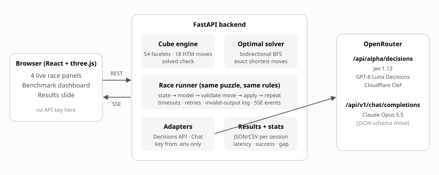

# Rubik's Cube Race: Fast Decision Models vs. a Frontier LLM

**AI Engineering, Assignment 02** · Syed Fahad Faheem Shah · Roll No. 23K-0062

**▶ Demo video (screen recording):** [Watch on Google Drive](https://drive.google.com/file/d/1rPq-ZaCOy-Y8f5xzLLTMd3TDSLDAwubB/view?usp=sharing)

Is a model that decides in milliseconds more useful than a frontier LLM that spends longer planning, if the
slower model solves the task in fewer moves? Four models race on the **same scrambled 3×3 cube**, one move at a
time, through OpenRouter, and the app measures speed and solution quality.

| Model | Category | OpenRouter ID | Interface |
|---|---|---|---|
| Jev 1.13 | System-1 decision model | `typesafe/jev-1.13` | Decisions API |
| GPT-6 Luna Decisions | System-1 decision model | `openai/gpt-6-luna-decisions` | Decisions API |
| Cloudflare Clef | System-1 decision model | `cloudflare/clef` | Decisions API |
| Claude Opus 5.5 | Frontier LLM | `anthropic/claude-opus-5.5` | Chat completions |



---

## What the app does

- **Game interface:** four live race panels with animated 3D cubes (drag to rotate), an unfolded net of all six
  faces, live timers, the current move with its latency and confidence, move history, and a clear
  **SOLVED ✓ / RAN OUT OF MOVES / API ERROR / API BUDGET REACHED** result.
- **Deterministic cube engine** (`backend/app/cube/engine.py`): a 54-facelet state and the 18 half-turn-metric
  moves, derived from a 3D sticker model and verified against published reference states.
- **Exact shortest solutions** (`backend/app/cube/solver.py`): bidirectional breadth-first search, tested against
  brute-force BFS. The optimality gap is measured against the true optimum.
- **Benchmark dashboard and results slide:** per-move average latency, total solve time, total moves, success
  rate, optimality gap, API calls, cache hits and actual cost, for each model.
- **Name and roll number** are shown on every screen.

## How the AI plays (state → action)

As with the Snake game from class, the game is a state/action space. Every turn each model gets the same
observation (the 54-facelet state in Kociemba order, the six faces as 3×3 grids, a format description, recent
moves, moves made/remaining) and must choose **one of 18 actions**: `U U' U2 R R' R2 F F' F2 D D' D2 L L' L2 B B' B2`.

- **Decision models:** `POST https://openrouter.ai/api/alpha/decisions` with one typed `choice` question whose
  options are the 18 moves. The app reads `answers.next_move.choice` and records `confidence` and `probabilities`.
  The question wording and options are identical for all three decision models; only the model ID differs.
- **LLM:** `POST https://openrouter.ai/api/v1/chat/completions` with the same observation and move definitions;
  a JSON schema restricts the reply to `{"move": <one of 18>}`.
- Every reply is **validated before it is applied**. Malformed or illegal output is logged and counted, never
  silently converted into a move. The scramble is never sent to a model.

## Course rules implemented (enforced in the backend)

| Rule | How |
|---|---|
| Start exactly **3 moves** from solved | test set `three`: the scramble is verified by exact search to be at distance 3 |
| **20-move** limit, then "unsolved" | `MAX_MOVES=20` |
| **Claude: max 5 requests**, unsolved if not solved in 5 moves | `LLM_CALL_CAP=5`, `LLM_MOVE_LIMIT=5` |
| **65 requests total** (20 per decision model + 5 Claude) | `DECISION_CALL_CAP=20`, `TOTAL_CALL_CAP=65` |
| Failed requests and retries count | a request is counted *before* it is sent; retries default to 0 |
| No infinite loops | every loop is bounded |
| **Persistent cache**, checked before every request | `backend/data/cache.json`, keyed by provider + endpoint + model + exact request |
| Counters never reset on restart | `backend/data/usage.json` is read from disk at startup |
| Live latency logged separately from cache time | `backend/logs/api.log`, and separate metrics in the results |
| One good OpenRouter experiment | OpenRouter sessions are limited to 1 puzzle |
| Record solve status, moves, latency, gap, API calls, cache hits, cost | `backend/results/openrouter/*.json` and `.csv`, and the dashboard |
| Key never leaked | `backend/.env` only (git-ignored); the browser never receives it |

Cached answers are free: they don't count toward the budget and cost `$0`, and the original live latency of a
cached answer is stored with it. **Actual cost** is the API's own `usage.cost`, never an estimate.

### Metrics

| Metric | Definition |
|---|---|
| Per-move average latency | mean model response time per move (live latency; for a cached answer, its original live latency) |
| Total solve time | wall-clock time for the puzzle until solved or a limit was hit |
| Total moves / success rate | moves executed / solved puzzles ÷ puzzles × 100 |
| Optimality gap | `model moves − exact shortest moves`, over solved puzzles. 0 = optimal |
| API calls, cache hits, cost | live requests sent / answers served from cache / actual USD |

---

## Setup

Requirements: **Python 3.11+** and **Node 18+**. A real run needs an OpenRouter API key.

```bash
# 1. Backend
cd backend
python -m venv .venv                   # Windows: .venv\Scripts\activate
pip install -r requirements.txt
cp .env.example .env                   # Windows: copy .env.example .env

# 2. Frontend (build once)
cd ../frontend
npm install
npm run build

# 3. Run: FastAPI serves the API and the built UI
cd ../backend
python -m uvicorn app.main:app --port 8000        # open http://localhost:8000
```

Or use `./start.ps1` (Windows) / `./start.sh`. For development with hot reload run
`uvicorn app.main:app --reload` and `npm run dev` (Vite proxies `/api`).

### Providers

`PROVIDER` in `backend/.env` selects:

- `mock` (default): simulated models, no API key and no cost. A banner shows that data is simulated.
- `openrouter`: the real experiment. Set `OPENROUTER_API_KEY` in `backend/.env`. **Never commit `.env`.**

### Pre-flight check

```bash
cd backend
python -m app.check            # dry run: makes no API requests
python -m app.check --live     # one cached request per model (counts toward the budget; asks you to type YES)
```

### Run the experiment

Open the app, choose test set `three`, first seed `1`, 1 puzzle, and click **Run benchmark**.

### Tests

```bash
cd backend
python -m pytest -q
```

63 tests cover the cube engine, the exact solver (against brute-force BFS), the request/response handling for both
interfaces, the gateway (cache hits and misses, persistence across restarts, the 5/20/65 caps, failed requests
counted, errors never cached), the runner and statistics, and an **offline end-to-end rehearsal of the whole
OpenRouter experiment** against a fake transport. Tests use temporary folders and never touch the real cache,
ledger or logs.

## Project structure

```
backend/
  app/
    cube/            engine.py (state, moves), solver.py (exact BFS), scramble.py (seeded test sets)
    gateway.py       persistent cache + budget ledger + request log; every model request goes through it
    agents/          decisions.py, chat.py, mock.py
    benchmark/       runner.py (races, live events), stats.py, store.py
    prompts.py       the single game-action contract shared by all models
    main.py          FastAPI app;   check.py  pre-flight check
  tests/
  results/openrouter/   saved results of the real run (JSON + CSV)
frontend/            React + three.js: race panels, dashboard, results slide
```

`backend/data/` (cache and budget ledger) and `backend/logs/` are created at runtime and are git-ignored.

---

## Results (real OpenRouter run)

One puzzle, exactly 3 moves from solved (`three-1`: scramble `F2 R2 L2`, exact optimum **3 moves**: `R2 L2 F2`).
Saved in `backend/results/openrouter/`.

| Model | Result | Moves | Avg latency / move | Total time | API calls · cache hits | Cost |
|---|---|---|---|---|---|---|
| Claude Opus 5.5 | **Solved**, gap 0 | 3 (limit 5) | 24.4 s (live 20.4 s) | 41.0 s | 2 · 1 | $0.0592 |
| Jev 1.13 | Not solved: request budget reached | 19 | **0.91 s** | 16.7 s | 18 · 1 | $0.0009 |
| GPT-6 Luna Decisions | Not solved: API error (refused) | 3 | 1.16 s | 3.4 s | 3 · 1 | $0.0001 |
| Cloudflare Clef | Not solved: request budget reached | 19 | 1.01 s | 18.7 s | 18 · 1 | $0.0007 |

Total across the whole experiment (including the pre-flight requests): **49 of 65 requests**, $0.1083.
Claude used 3 of its 5 requests.

**Notes on these results:**

- **One puzzle only**, as the instructions required, so success rate is 100% or 0% per model. This is a small
  sample, not strong statistical evidence.
- **GPT-6 Luna refused the question.** `openai/gpt-6-luna-decisions` returned HTTP 502 "OpenAI refused to answer
  question" for the first (longer) instruction wording. All three decision models therefore use one shorter
  wording. Luna then answered 3 moves and refused the fourth request. Refused requests still count toward the budget.
- **Jev and Clef stopped at move 19, not 20**, because two of their 20 requests were spent in the pre-flight
  check, so they hit the request cap first. The models were not close to solving the cube at that point.
- The decision models kept oscillating (for example `U2 U2 U2 U2 …`) instead of making progress. At the end,
  Clef had 38/54 facelets correct, and Jev and Luna 26/54.
- The first move of each model came from the persistent cache (answered earlier in the pre-flight check), shown
  as a dashed chip in the UI.

## Findings: the five questions

1. **Which model is fastest at making decisions?** Jev 1.13: 0.91 s per move on average (median 0.85 s). Clef
   (1.01 s) and Luna (1.16 s) were close. Claude took 24.4 s per move (20.4 s on live requests), about
   **27× slower** than Jev.
2. **Which model had the highest solve rate?** Claude Opus 5.5: 1 of 1 puzzles (100%). The three decision models
   solved 0 of 1.
3. **Which model found the shortest solutions, and how close to the optimum?** Only Claude solved the puzzle, in
   3 moves, which is **exactly the optimum (gap 0)**. The others have no solution to compare.
4. **Did the fastest model also achieve the best solution quality?** **No.** Jev was the fastest but did not solve
   the cube; the slowest model, Claude, produced the only (and an optimal) solution.
5. **Fast decision model, frontier LLM, or a hybrid in a real application?** For a task that needs multi-step
   planning where each move depends on the cube state, as here, I would use the **frontier LLM**. It was the only
   model that solved the puzzle (3 moves, optimal), while the decision models, despite being ~27× faster per
   decision, wandered without progress. The cost of that quality is latency (41 s total) and money ($0.059 versus
   under $0.001 per decision model). I would use a fast decision model for single-step, well-defined choices
   (such as routing or classification), where one quick answer is enough. A **hybrid** (the LLM plans, fast models
   handle simple choices) is the practical default, but this experiment did not test a hybrid. This conclusion
   rests on one puzzle and should be treated as indicative only.
